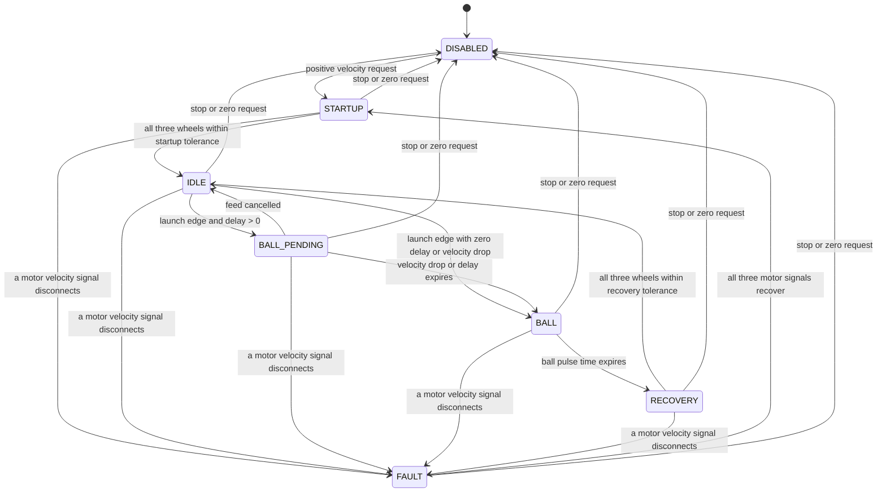

# Hooded Shooter Flywheel: Phase Control and Tuning Guide

This guide covers the robot's three-wheel fixed shooter and its servo-actuated hood. The shooter
does not rotate in azimuth: `ShooterAiming` points the chassis, while the hood changes the launch
elevation. The PWM hood servos report commanded positions, not measured mechanism angles.

The phase controller is in `subsystems/shooter/Shooter.java`; motor and servo IO are separated into
`ShooterIO`, `ShooterIOReal`, and `ShooterIOSim`. All tunable values are read from SmartDashboard
and written to AdvantageKit logs when read. Values with safety bounds also log an `/Effective`
entry showing the value actually used after clamping.

## Phase behavior

Each active phase selects an output in the same scheduler cycle, so `Shooter/ControlPhase` and
`Shooter/ControlOutput` describe the command currently being sent:

| Phase | Output | Purpose |
| --- | --- | --- |
| `STARTUP` | `VelocityDutyCycle`, slot 1 | Quickly spool the wheels with the forward-only bang-bang setup. |
| `IDLE` | `VelocityVoltage`, slot 0 | Hold the requested speed with per-wheel feedforward and PID gains. |
| `BALL_PENDING` | `VelocityVoltage`, slot 0 | Keep speed regulated while waiting for an observed droop or a tuned feed-to-wheel delay. |
| `BALL` | `TorqueCurrentFOC` pulse | Apply the tuned positive current while a piece enters the wheels. |
| `RECOVERY` | `VelocityDutyCycle`, slot 1 | Re-spool quickly, then return to closed-loop holding. |
| `DISABLED` | motor stop | Clear requests on stop and whenever the Driver Station is disabled. |
| `FAULT` | motor stop | Hold outputs off until all three velocity signals recover. |

The rising edge of `LaunchActive` starts a ball event. With the default zero delay, it enters
`BALL` immediately, preserving the existing behavior. Set `Shooter/Phase/LaunchToBallDelaySec` if
the indexer needs time to move a piece from the feeder to the flywheels. A measured flywheel speed
drop larger than `BallEntryDropRPM` starts `BALL` immediately, even while that delay is pending.
The drop is measured from the flywheel speed reference captured when feeding begins and must also
be below the requested speed. This avoids treating an ordinary increase in the shot RPM request as
a ball impact. After recovery, the event detector rearms for the next piece.

Startup and recovery readiness require all three motor signals to be connected and each measured
wheel speed to be inside its own error tolerance. A disconnected wheel cannot be hidden by the
three-wheel average; a disconnect while active moves the controller to `FAULT` and stops all
flywheels. The normal shot-ready check separately requires all wheels to satisfy
`VelocityToleranceRPM`, the hood's settle timer to elapse, and the superstructure's shot solution
to be ready. Compare these tolerances when deciding when to allow a phase transition and when to
allow feeding.

## Dashboard controls and ranges

The ranges below are enforced in code. Values outside them are clamped and the effective value is
logged beside the raw NetworkTables value.

| Dashboard key | Default | Range / unit | Use |
| --- | ---: | --- | --- |
| `Shooter/Flywheels/{Left,Middle,Right}/kS` | 0.90165 | 0-12 V | Static voltage needed to start/maintain wheel motion. Tune independently per wheel. |
| `Shooter/Flywheels/{Left,Middle,Right}/kV` | 0.13386 | 0-12 V/(rotation/s) | Voltage feedforward per requested mechanism speed. |
| `Shooter/Flywheels/{Left,Middle,Right}/kA` | 0.0 | 0–12 V/(rotation/s²) | Configured but currently unused: the velocity request sends zero acceleration. Keep at 0 unless code supplies an acceleration target. |
| `Shooter/Flywheels/{Left,Middle,Right}/kP` | 0.5 | 0–100 V/(rotation/s) | Corrects instantaneous speed error. |
| `Shooter/Flywheels/{Left,Middle,Right}/kI` | 2.0 | 0–100 V/rotation | Corrects persistent speed error. Start at zero during initial tuning. |
| `Shooter/Flywheels/{Left,Middle,Right}/kD` | 0.0 | 0–100 V/(rotation/s²) | Damping; usually zero for a flywheel unless logs show overshoot. |
| `Shooter/BangBang/kP` | 999999 | 1–1,000,000 | Slot 1 gain used for fast startup and recovery. |
| `Shooter/Phase/StartupReadyToleranceRPM` | 80 | 1–1,000 RPM, then capped at 25% of target | Per-wheel error allowed before leaving startup. |
| `Shooter/Phase/RecoveryReadyToleranceRPM` | 60 | 1–1,000 RPM, then capped at 25% of target | Per-wheel error allowed before rearming from recovery. |
| `Shooter/Phase/BallEntryDropRPM` | 120 | 1–2,000 RPM | Speed loss that identifies a piece reaching the flywheels. |
| `Shooter/Phase/LaunchToBallDelaySec` | 0.0 | 0–0.5 s | Delay after the feeder starts before the fallback ball pulse. |
| `Shooter/Phase/BallDurationSec` | 0.06 | 0.02–0.5 s | Length of the torque-current pulse. |
| `Shooter/Phase/BallTorqueCurrentAmps` | 29 | 0–120 A and no more than the configured peak torque current | Positive current requested during `BALL`. |
| `Shooter/CurrentLimit/StatorAmps` | 120 | 1–120 A | Per-motor stator current limit. |
| `Shooter/CurrentLimit/TorqueAmps` | 120 | 0–120 A | Peak positive torque current allowed by the motor config. |
| `Shooter/Tuning/MaxVelocityRPM` | 6,000 | 1–6,000 RPM | Software ceiling for every flywheel velocity request. |
| `Shooter/Tuning/VelocityToleranceRPM` | 100 | 1–500 RPM | Per-wheel tolerance used by the shot-ready check. |
| `Shooter/Tuning/TargetRPM` | 2,500 | 0–MaxVelocityRPM | Target used by the dashboard run command. |
| `Shooter/Tuning/HoodAngleDeg` | 35 | 20–65 degrees | Target used by the dashboard hood and shooter tuning commands. |
| `Shooter/Characterization/RampVoltsPerSec` | 0.5 | 0.05–2.0 V/s | Open-loop characterization ramp rate. |
| `Shooter/Characterization/MaxVolts` | 6.0 | 0–6 V | Open-loop characterization ceiling. |

Phoenix `VelocityVoltage` uses rotations per second for velocity, so the characterization command
fits `kV` in V/(rotation/s). The PID and feedforward gains are voltage-output gains. The per-wheel
`kS`, `kV`, `kA`, `kP`, `kI`, and `kD` are live tunables; a change is applied to the corresponding
TalonFX on the next enabled subsystem loop.

The `BALL` request uses `TorqueCurrentFOC`, which requires a Phoenix Pro license. CTRE disables
that output and raises an unlicensed-feature fault if the TalonFX is not licensed. Confirm the
hardware license before tuning ball current; inspect `Shooter/UnlicensedFeatureFault/Any` and the
per-wheel fault signals in AdvantageScope/Tuner.

## Standalone Phoenix Tuner X, then robot-code handoff

This workflow starts before the robot program is deployed. Phoenix Tuner X's temporary diagnostics
server provides device discovery, configuration, control, self-test, and plotting without the robot
code. After that pass, copy accepted device settings into the source defaults and use the robot's
commands and AdvantageKit logs to validate the same wheels and tune the phase behavior.

### 1. Start Phoenix Tuner X without robot code

1. **Make the mechanism safe.** Remove game pieces, clear people and tools from the flywheel path,
   and secure the robot. Check the hood and wheels by hand with power off. Keep an accessible
   emergency stop. Do not use reverse output for this shooter. Begin with one wheel at a time and
   use low positive voltage only.
2. **Start the temporary diagnostics server.** In Phoenix Tuner X, connect to the roboRIO IP
   `10.TE.AM.2` (replace `TE.AM` with the team number) or select the Driver Station preset. From the
   connection menu, select **Run Temporary Diagnostic Server**. Wait for the server to start and
   the devices to appear. The temporary server lasts until the roboRIO reboots. Phoenix 6 requires
   the correct Phoenix 6 firmware on the TalonFXs.
3. **Meet FRC enable requirements for motor control.** Tuner X can inspect and configure devices
   without a robot program. Its Control tab still requires the FRC Driver Station to be enabled
   before a TalonFX will actuate. Enable only when ready to run the controlled test; disable Tuner X
   output before changing wiring, working near the mechanism, or leaving the test station.
4. **Identify and check each device.** Confirm TalonFX IDs `41` (left), `42` (middle), and `43`
   (right), model, firmware, and no duplicate IDs. Use the blink action to confirm physical mapping.
   Open each Self Test and resolve disconnected devices or active faults before tuning. Check the
   Pro license state on all three controllers because the deployed `BALL` phase uses
   `TorqueCurrentFOC`.
5. **Back up and inspect configuration.** Copy or back up each TalonFX config before changing it.
   Check `Motor Output`, `Current Limits`, `Feedback`, `Slot 0`, and `Slot 1`. Current robot-code
   expectations are a 1:1 sensor-to-mechanism ratio, coast neutral, left/middle
   `CounterClockwise_Positive`, right `Clockwise_Positive`, 120 A stator and peak torque limits,
   Slot 0 for velocity holding, and Slot 1 for startup/recovery. Confirm the ratio and inversion
   against the actual mechanism before applying output. If the hardware requires different values,
   record them for the code handoff.
6. **Prepare plots.** For each device, add velocity, motor voltage, stator current, supply voltage,
   and faults when available. Use the multi-device Signal & Control view to compare the three
   wheels, or tune one controller at a time in its device view. Clear the plot between runs. Export
   the visible data to CSV and record the device ID, config, target, and test condition.

### 2. Tune with standalone Tuner X

Tuner X Configs changes TalonFX settings; its Control tab sends requests directly to the selected
controller. Tuner X plots can show the device signals without AdvantageKit. Use the voltage loop
and units that match the deployed `VelocityVoltage` request: output in volts and velocity in
mechanism rotations per second. Do not transfer gain numbers from a TorqueCurrentFOC tuning example
to this voltage-output loop; their output units and behavior differ.

#### Method A: Open-loop voltage sweep for feedforward estimates

1. In Control, choose Voltage output. With no piece in the shooter, test one wheel at a time. Start
   at 0 V and raise the positive voltage in small steps (about 0.5 V at a time); wait for velocity
   to settle at each step and plot actual motor voltage, velocity, and current. Keep this initial
   sweep at or below 6 V, and stop sooner if the wheel approaches its approved speed/current limit,
   vibrates, heats, or sounds abnormal.
2. For each stable plateau, record actual applied voltage and measured wheel speed in rotations
   per second. Fit the steady-state points to `V = kS + kV * velocity`. The intercept estimates
   `kS`; the slope estimates `kV` in V/(rotation/s). Use actual motor voltage so battery sag is
   reflected in the data. Do not use the accelerating part of the ramp to estimate `kA` or the
   steady-state `kV`: acceleration voltage contaminates a steady-state fit.
3. Repeat the sweep and compare the left, middle, and right fits. Keep wheel-specific values if
   friction or inertia differs. This is an estimate, not a final shot calibration. Avoid treating
   the exact voltage where a stopped wheel first breaks free as the whole `kS` fit; validate at
   several running speeds.

#### Method B: Closed-loop velocity tuning in Tuner X

1. In Configs, confirm the feedback ratio and edit only Slot 0 while tuning. Start with `kI = 0`,
   `kD = 0`, and `kA = 0`; use the open-loop `kS`/`kV` estimates if available and begin with a small
   `kP`. Apply the config to one TalonFX, then select its velocity closed-loop control in Control.
   Confirm the control is using Slot 0 and that the displayed velocity unit is rotations per second.
2. Start at a low target, roughly 10% of the approved maximum. For this code's 6,000 RPM ceiling,
   10 rotations/s is 600 RPM. Increase `kS` only enough to remove low-speed steady error, then test
   a high but approved target (up to 80 rotations/s / 4,800 RPM only if the mechanism is rated for
   it) and adjust `kV` to remove speed-dependent steady error. Iterate between low and high targets.
   Keep output voltage and current within the mechanism and electrical limits.
3. With feedforward close, raise `kP` gradually to improve response. If the wheel sustains
   oscillation, reduce `kP` until it tracks without oscillating. A useful starting estimate is
   `kP = desired correction volts / observed velocity error in rotations/s`; for example, a 0.5 V
   correction at 5 rotations/s error is 0.1 V/(rotation/s). Only add `kI` if repeatable steady error
   remains after `kS` and `kV` are sound. Flywheels usually start with `kD = 0`; add it only if plots
   show a specific damping problem and the signal is clean.
4. Repeat per TalonFX, then compare all three at identical low, middle, and high targets. Record the
   final Slot 0 gains from each Configs tab, not just the values you remember entering. Save a config
   backup and the Tuner plot CSV for the accepted pass.

Tuner X's Control and Plot can be used together to adjust configs and calculate closed-loop gains.
Tuner X also supports multi-device plot and control for mechanisms with several motors. First check
wheel direction and limits individually; compare all three together after each is safe.

### 3. Other useful tuning methods

| Method | When to use it | What it provides / limitation |
| --- | --- | --- |
| Tuner X voltage sweep | Before robot code is running | Quick per-wheel `kS`/`kV` estimates from stable voltage/speed data. It does not produce a robust `kA` estimate by itself. |
| Tuner X velocity loop | Before robot code is running | Direct TalonFX Slot 0 tuning with live plot feedback. Gains must be copied into the code before deployment. |
| WPILib SysId simple motor | After adding and deploying a SysId routine | Fits `kS`, `kV`, and `kA` from logged quasistatic/dynamic tests and provides diagnostic plots. The existing project does not currently expose a SysId shooter routine. |
| Shooter feedforward command | After deploying this robot code | Existing command ramps all three wheels to at most 6 V and reports per-wheel `kS`/`kV`; it does not fit `kA` and its accelerating samples make the fit a starting estimate. |
| Repeatable shot trials | After closed-loop speed is stable | Tunes launch delay, ball pulse duration/current, hood map, and recovery behavior. Change one value per set of comparable shots. |

SysId is the stronger identification option when you want a measured `kA` as well as `kS` and `kV`.
It requires a SysId-compatible routine in robot code; the temporary Tuner X server alone cannot create
that routine or produce a WPILib SysId log. Before copying a SysId fit into Phoenix gains, convert
its velocity and acceleration units to the TalonFX mechanism units used here (rotations/s and
rotations/s^2). For a fit expressed per radian/s, multiply `kV` by `2*pi` to express it per
rotation/s. `kA` is currently configured in the code, but `ShooterIOReal` sends
`VelocityVoltage.withVelocity(...)` without an acceleration target; Phoenix's request defaults
acceleration to zero, so `kA` currently contributes nothing to this shooter command. Leave it at
zero unless the code is changed to provide acceleration.

### 4. Transfer the Tuner X results into robot code

1. Save the accepted configs and write down each device ID, inversion, sensor ratio, current limits,
   Slot 0 gains, test targets, and any faults. Keep the three wheel records separate. Tuner X config
   edits are stored on the TalonFX, but they do not update `LoggedTunableNumber` values in Java.
2. Copy accepted per-wheel `kS`, `kV`, `kP`, `kI`, and `kD` values into the matching defaults in
   `ShooterConstants.Flywheel`. Copy any required static config changes into `ShooterIOReal` too.
   The constructor applies a full TalonFX config at startup, so code deployment will replace
   Tuner-only values. The source defaults are the permanent settings; SmartDashboard changes are
   runtime tuning only.
3. Keep `kA = 0` for this velocity command. Set code-side `kI = 0` initially even though its
   current source default is `2.0`; set it deliberately in the source before the first enabled
   tuning run. Deploy the robot code. When the robot instantiates the TalonFXs, the normal Phoenix
   diagnostics server starts; reconnect Tuner X to that server if you still want live device plots.
4. With game pieces removed, run the SmartDashboard command
   `Shooter/Tuning/Run At Tunable Setpoint`. Verify that all three wheels spin in the expected
   direction and that `Left/Middle/RightVelocityRPM` match the setpoint before feeding anything.
   Use Tuner X plots for device signals and AdvantageKit/AdvantageScope for the code-side setpoint,
   phase, and event logs.
5. Run `Shooter/Tuning/Feedforward Characterization` as an independent code-side check. It ramps
   all three wheels at the configured rate to at most 6 V and logs/prints per-wheel
   `Shooter/Characterization/{Left,Middle,Right}/{kS,kV,SampleCount}`. Compare its `kS`/`kV` fits
   with the Tuner X estimate. Copy final values to source defaults, then verify low, middle, and high
   targets with `Shooter/Tuning/Run At Tunable Setpoint`. Check raw and `/Effective` logs to confirm
   the code applied the values you expect.
6. Tune startup/recovery thresholds and `Shooter/BangBang/kP` after the holding loop works. Then
   run controlled shots through the `SHOOTING` flow to tune `LaunchToBallDelaySec`, ball duration,
   and torque current. Tune the hood servo direction and 20 to 65 degree range with
   `Shooter/Hood/Move to Tunable Angle`, then tune `ShooterSetpoints` by repeating shots at known
   distances. The chassis handles yaw; this is a fixed, hooded shooter, not a turret.

## Reading the logs

Start with `Shooter/ControlPhase`, `Shooter/ControlOutput`, `Shooter/LastPhaseTransition`,
`Shooter/PhaseElapsedSec`, and `Shooter/LastPhaseDurationSec`. Compare `Shooter/VelocitySetpointRPM`
to the three individual RPM and error traces. For feed timing, inspect the `Shooter/Launch*` and
`Shooter/Ball*` keys. `Shooter/FlywheelAtSetpoint` and `Shooter/AtSetpoint` show why normal feeding
is waiting; `Shooter/HoodHardwareConfigured` and `Shooter/HoodAtSetpoint` isolate hood gating.
`Shooter/LeftVoltage`, `MiddleVoltage`, `RightVoltage`, current traces, connection flags, and
`UnlicensedFeatureFault/*` help distinguish tuning issues from a disconnected or unlicensed motor.

## Reference patterns

- [Mechanical Advantage's 2026 `Flywheel.java`](https://github.com/Mechanical-Advantage/RobotCode2026Public/blob/main/src/main/java/org/littletonrobotics/frc2026/subsystems/launcher/flywheel/Flywheel.java)
  demonstrates a separated flywheel IO path, AdvantageKit input logging, and live `LoggedTunableNumber`
  gains. This robot uses that logging/control pattern while retaining its own three-wheel phase logic.
- [Mubotics 7157's 2026 Splitstream repository](https://github.com/Mubotics7157/2026-Splitstream)
  demonstrates the WPILib 2026 / AdvantageKit IO layering and subsystem organization. Its shooter is
  turret-based; only the reusable software structure applies here. The fixed shooter aims with the
  chassis and uses its hood for elevation.
- [CTRE Phoenix 6 velocity control documentation](https://pro.docs.ctr-electronics.com/en/stable/docs/api-reference/device-specific/talonfx/talonfx-control-intro.html)
  documents the TalonFX output control types and the Pro-license requirement for `TorqueCurrentFOC`.
- [CTRE Phoenix Tuner X connection guide](https://pro.docs.ctr-electronics.com/en/stable/docs/tuner/connecting.html),
  [device configuration guide](https://pro.docs.ctr-electronics.com/en/stable/docs/tuner/configs.html),
  [controlling devices](https://pro.docs.ctr-electronics.com/en/stable/docs/tuner/controlling-devices.html),
  and [plotting guide](https://pro.docs.ctr-electronics.com/en/stable/docs/tuner/plotting.html)
  document the hardware preflight and Tuner X workflow.
- [CTRE multi-device Plot & Control](https://pro.docs.ctr-electronics.com/en/stable/docs/tuner/signal-and-control.html)
  covers plotting multiple TalonFXs together, which is useful for comparing the three shooter wheels.
- [CTRE TalonFX closed-loop overview](https://pro.docs.ctr-electronics.com/en/stable/docs/api-reference/device-specific/talonfx/closed-loop-requests.html)
  describes manual velocity tuning for the voltage output loop used here. CTRE's separate
  [TorqueCurrentFOC flywheel example](https://pro.docs.ctr-electronics.com/en/stable/docs/api-reference/device-specific/talonfx/manual-pid-tuning.html)
  uses a different output mode, so do not copy its current-based gain values into `VelocityVoltage`.
- [Phoenix 6 `VelocityVoltage` Java API](https://api.ctr-electronics.com/phoenix6/stable/java/com/ctre/phoenix6/controls/VelocityVoltage.html)
  documents rotations-per-second velocity and the acceleration request used by `kA`.
- [WPILib SysId introduction](https://docs.wpilib.org/en/latest/docs/software/advanced-controls/system-identification/introduction.html)
  and [routine setup](https://docs.wpilib.org/en/latest/docs/software/advanced-controls/system-identification/creating-routine.html)
  explain the code routine and logged-data workflow required for a SysId characterization.
- [CTRE actuator enabling and FRC Lock](https://pro.docs.ctr-electronics.com/en/stable/docs/api-reference/api-usage/enabling-actuators.html)
  explains why Phoenix Tuner X motor control follows the Driver Station enable signal.
