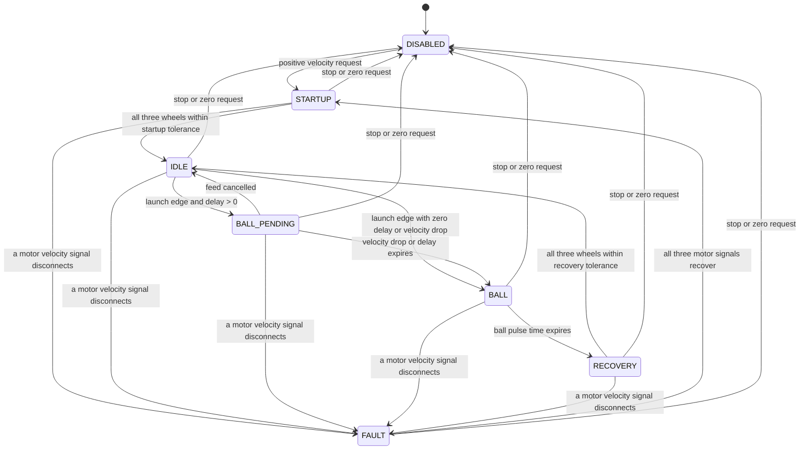

# Hooded Shooter Flywheel: Phase Control and Tuning Guide

This guide covers the robot's three-wheel fixed shooter and its servo-actuated hood. The shooter
does not rotate in azimuth: `ShooterAiming` points the chassis, while the hood changes the launch
elevation. The PWM hood servos report commanded positions, not measured mechanism angles.

The phase controller is in `subsystems/shooter/Shooter.java`; motor and servo IO are separated into
`ShooterIO`, `ShooterIOReal`, and `ShooterIOSim`. All tunable values are read from SmartDashboard
and written to AdvantageKit logs when read. Values with safety bounds also log an `/Effective`
entry showing the value actually used after clamping.

## Phase behavior

Each active phase selects an output in the same scheduler cycle, so `Shooter/ControlPhase` and
`Shooter/ControlOutput` describe the command currently being sent:

| Phase | Output | Purpose |
| --- | --- | --- |
| `STARTUP` | `VelocityDutyCycle`, slot 1 | Quickly spool the wheels with the forward-only bang-bang setup. |
| `IDLE` | `VelocityVoltage`, slot 0 | Hold the requested speed with per-wheel feedforward and PID gains. |
| `BALL_PENDING` | `VelocityVoltage`, slot 0 | Keep speed regulated while waiting for an observed droop or a tuned feed-to-wheel delay. |
| `BALL` | `TorqueCurrentFOC` pulse | Apply the tuned positive current while a piece enters the wheels. |
| `RECOVERY` | `VelocityDutyCycle`, slot 1 | Re-spool quickly, then return to closed-loop holding. |
| `DISABLED` | motor stop | Clear requests on stop and whenever the Driver Station is disabled. |
| `FAULT` | motor stop | Hold outputs off until all three velocity signals recover. |

The rising edge of `LaunchActive` starts a ball event. With the default zero delay, it enters
`BALL` immediately, preserving the existing behavior. Set `Shooter/Phase/LaunchToBallDelaySec` if
the indexer needs time to move a piece from the feeder to the flywheels. A measured flywheel speed
drop larger than `BallEntryDropRPM` starts `BALL` immediately, even while that delay is pending.
The drop is measured from the flywheel speed reference captured when feeding begins and must also
be below the requested speed. This avoids treating an ordinary increase in the shot RPM request as
a ball impact. After recovery, the event detector rearms for the next piece.

Startup and recovery readiness require all three motor signals to be connected and each measured
wheel speed to be inside its own error tolerance. A disconnected wheel cannot be hidden by the
three-wheel average; a disconnect while active moves the controller to `FAULT` and stops all
flywheels. The normal shot-ready check separately requires all wheels to satisfy
`VelocityToleranceRPM`, the hood's settle timer to elapse, and the superstructure's shot solution
to be ready. Compare these tolerances when deciding when to allow a phase transition and when to
allow feeding.

## Dashboard controls and ranges

The ranges below are enforced in code. Values outside them are clamped and the effective value is
logged beside the raw NetworkTables value.

| Dashboard key | Default | Range / unit | Use |
| --- | ---: | --- | --- |
| `Shooter/Flywheels/{Left,Middle,Right}/kS` | 0.0 | 0–12 V | Static voltage needed to start/maintain wheel motion. Tune independently per wheel. |
| `Shooter/Flywheels/{Left,Middle,Right}/kV` | 0.12 | 0–12 V/(rotation/s) | Voltage feedforward per requested mechanism speed. |
| `Shooter/Flywheels/{Left,Middle,Right}/kA` | 0.0 | 0–12 V/(rotation/s²) | Acceleration feedforward; leave zero until the basic loop is stable. |
| `Shooter/Flywheels/{Left,Middle,Right}/kP` | 0.5 | 0–100 V/(rotation/s) | Corrects instantaneous speed error. |
| `Shooter/Flywheels/{Left,Middle,Right}/kI` | 2.0 | 0–100 V/rotation | Corrects persistent speed error. Start at zero during initial tuning. |
| `Shooter/Flywheels/{Left,Middle,Right}/kD` | 0.0 | 0–100 V/(rotation/s²) | Damping; usually zero for a flywheel unless logs show overshoot. |
| `Shooter/BangBang/kP` | 999999 | 1–1,000,000 | Slot 1 gain used for fast startup and recovery. |
| `Shooter/Phase/StartupReadyToleranceRPM` | 80 | 1–1,000 RPM, then capped at 25% of target | Per-wheel error allowed before leaving startup. |
| `Shooter/Phase/RecoveryReadyToleranceRPM` | 60 | 1–1,000 RPM, then capped at 25% of target | Per-wheel error allowed before rearming from recovery. |
| `Shooter/Phase/BallEntryDropRPM` | 120 | 1–2,000 RPM | Speed loss that identifies a piece reaching the flywheels. |
| `Shooter/Phase/LaunchToBallDelaySec` | 0.0 | 0–0.5 s | Delay after the feeder starts before the fallback ball pulse. |
| `Shooter/Phase/BallDurationSec` | 0.06 | 0.02–0.5 s | Length of the torque-current pulse. |
| `Shooter/Phase/BallTorqueCurrentAmps` | 29 | 0–120 A and no more than the configured peak torque current | Positive current requested during `BALL`. |
| `Shooter/CurrentLimit/StatorAmps` | 120 | 1–120 A | Per-motor stator current limit. |
| `Shooter/CurrentLimit/TorqueAmps` | 120 | 0–120 A | Peak positive torque current allowed by the motor config. |
| `Shooter/Tuning/MaxVelocityRPM` | 6,000 | 1–6,000 RPM | Software ceiling for every flywheel velocity request. |
| `Shooter/Tuning/VelocityToleranceRPM` | 100 | 1–500 RPM | Per-wheel tolerance used by the shot-ready check. |
| `Shooter/Tuning/TargetRPM` | 2,500 | 0–MaxVelocityRPM | Target used by the dashboard run command. |
| `Shooter/Tuning/HoodAngleDeg` | 35 | 20–65 degrees | Target used by the dashboard hood and shooter tuning commands. |
| `Shooter/Characterization/RampVoltsPerSec` | 0.5 | 0.05–2.0 V/s | Open-loop characterization ramp rate. |
| `Shooter/Characterization/MaxVolts` | 6.0 | 0–6 V | Open-loop characterization ceiling. |

Phoenix `VelocityVoltage` uses rotations per second for velocity, so the characterization command
fits `kV` in V/(rotation/s). The PID and feedforward gains are voltage-output gains. The per-wheel
`kS`, `kV`, `kA`, `kP`, `kI`, and `kD` are live tunables; a change is applied to the corresponding
TalonFX on the next enabled subsystem loop.

The `BALL` request uses `TorqueCurrentFOC`, which requires a Phoenix Pro license. CTRE disables
that output and raises an unlicensed-feature fault if the TalonFX is not licensed. Confirm the
hardware license before tuning ball current; inspect `Shooter/UnlicensedFeatureFault/Any` and the
per-wheel fault signals in AdvantageScope/Tuner.

## Recommended tuning sequence

1. **Check hardware and mechanism limits.** Confirm CAN IDs, motor inversion, positive measured RPM
   for a positive setpoint, servo PWM channels, and hood clearance at both mechanical endpoints.
   `Shooter/Hood/RequestedAngleDeg` is the requested angle. The reported `HoodAtSetpoint` means the
   servo settle delay elapsed; it is not physical position feedback.
2. **Characterize each flywheel's voltage feedforward.** Remove game pieces and run the dashboard
   command `Shooter/Tuning/Feedforward Characterization`. The command ramps all wheels at the
   configured rate up to at most 6 V, samples each wheel, and reports initial `kS`/`kV` fits. The
   fitted values are logged at `Shooter/Characterization/{Left,Middle,Right}/{kS,kV}` and printed
   in the Driver Station console. Enter each fit in its matching per-wheel dashboard key. Treat
   these as starting estimates; verify at several steady speed targets because an accelerating
   wheel also has an acceleration voltage component.
3. **Tune closed-loop speed.** Run `Shooter/Tuning/Run At Tunable Setpoint` with the indexer held
   stopped. Start with `kI = 0`, `kD = 0`, and `kA = 0`. Check `VelocitySetpointRPM`, each
   `Left/Middle/RightVelocityRPM`, each `*ErrorRPM`, and applied voltage. Correct a persistent
   slope error with `kV`; increase `kP` gradually for quicker tracking. Add only enough `kI` to
   remove a persistent offset. Keep the three wheel loops independent if their mechanisms or
   friction differ.
4. **Check startup and recovery.** Confirm startup reaches `IDLE` reliably, then observe recovery
   after a shot. Adjust the ready tolerances only to change when the state transition is allowed;
   they are speed errors in RPM, not target RPMs. Tune the `BangBang/kP` only if the wheels fail to
   accelerate promptly or overshoot excessively. This output is intentionally forward-only.
5. **Tune piece timing and boost under controlled shots.** Use the actual `SHOOTING` flow so
   `LaunchActive` matches feeder operation; the dashboard setpoint command deliberately keeps the
   launch event inactive. Compare `LaunchActive`, `LaunchRisingEdge`, `BallEventPending`,
   `BallEntryDetected`, `BallEntrySource`, `BallVelocityReferenceRPM`, `BallVelocityDropRPM`,
   phase timestamps, and per-wheel RPM. First tune launch-to-wheel delay, then pulse duration,
   then torque current. Change one setting at a time and compare repeated shots with the same hood
   angle and distance. Keep current within the robot's electrical and mechanical limits.
6. **Tune the hood and shot map last.** Use `Shooter/Hood/Move to Tunable Angle` to check the servo
   direction and the safe 20–65 degree travel. Then collect repeatable shots at known distances and
   update `ShooterSetpoints` RPM and hood-angle maps. Do not use flywheel PID gains to correct a
   trajectory miss; wheel speed controls exit speed and the hood controls elevation. Chassis yaw
   alignment belongs to `ShooterAiming`/the drive controller because this robot has no turret.
7. **Save and replay.** Copy accepted dashboard numbers into the source defaults or shot maps before
   the next deployment; dashboard edits are runtime tuning, not the source of truth. Save a WPILOG
   from each tuning pass and compare the same AdvantageScope signals after changes. The active log
   includes both raw tunables and effective clamped values, so a surprising response can be tied
   to the actual setting used on that loop.

## Reading the logs

Start with `Shooter/ControlPhase`, `Shooter/ControlOutput`, `Shooter/LastPhaseTransition`,
`Shooter/PhaseElapsedSec`, and `Shooter/LastPhaseDurationSec`. Compare `Shooter/VelocitySetpointRPM`
to the three individual RPM and error traces. For feed timing, inspect the `Shooter/Launch*` and
`Shooter/Ball*` keys. `Shooter/FlywheelAtSetpoint` and `Shooter/AtSetpoint` show why normal feeding
is waiting; `Shooter/HoodHardwareConfigured` and `Shooter/HoodAtSetpoint` isolate hood gating.
`Shooter/LeftVoltage`, `MiddleVoltage`, `RightVoltage`, current traces, connection flags, and
`UnlicensedFeatureFault/*` help distinguish tuning issues from a disconnected or unlicensed motor.

## Reference patterns

- [Mechanical Advantage's 2026 `Flywheel.java`](https://github.com/Mechanical-Advantage/RobotCode2026Public/blob/main/src/main/java/org/littletonrobotics/frc2026/subsystems/launcher/flywheel/Flywheel.java)
  demonstrates a separated flywheel IO path, AdvantageKit input logging, and live `LoggedTunableNumber`
  gains. This robot uses that logging/control pattern while retaining its own three-wheel phase logic.
- [Mubotics 7157's 2026 Splitstream repository](https://github.com/Mubotics7157/2026-Splitstream)
  demonstrates the WPILib 2026 / AdvantageKit IO layering and subsystem organization. Its shooter is
  turret-based; only the reusable software structure applies here. The fixed shooter aims with the
  chassis and uses its hood for elevation.
- [CTRE Phoenix 6 velocity control documentation](https://pro.docs.ctr-electronics.com/en/stable/docs/api-reference/device-specific/talonfx/talonfx-control-intro.html)
  documents the TalonFX output control types and the Pro-license requirement for `TorqueCurrentFOC`.
